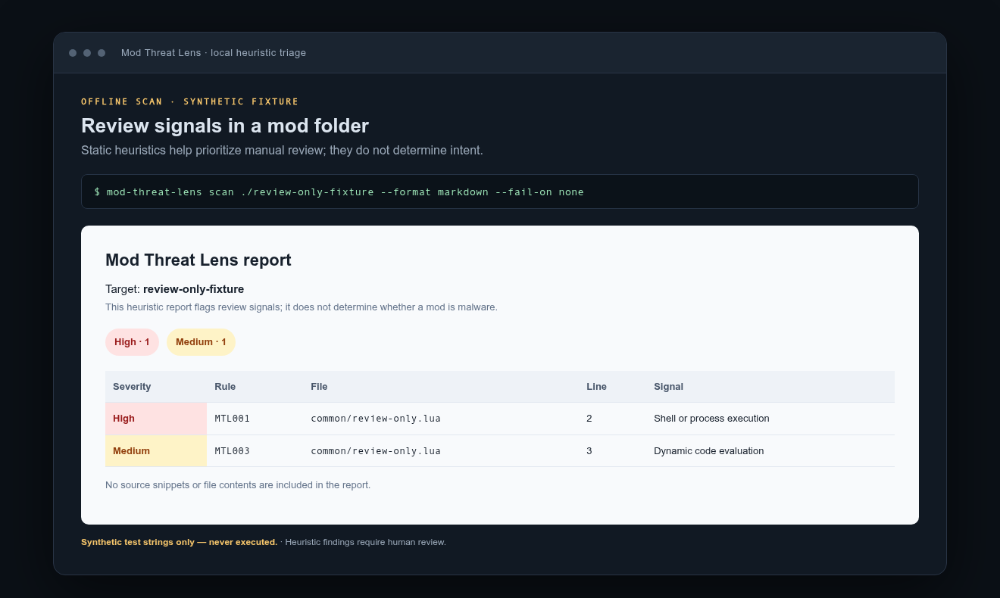

# Mod Threat Lens

**Local-first security triage for game mods.** Scan a mod folder, file, or ZIP for risky execution patterns, suspicious payloads, and unsafe archive entries—without extracting archives or uploading mod contents.

[](https://github.com/GhosTnever-lkm/mod-threat-lens/actions/workflows/ci.yml) [](https://github.com/GhosTnever-lkm/mod-threat-lens/releases) [](LICENSE)



*Example findings from synthetic strings that are scanned but never executed. Heuristic signals require manual review and are not a malware verdict.*

> **Important:** Mod Threat Lens is a heuristic review aid—not antivirus, a sandbox, or a malware verdict. Findings can be false positives; a clean scan does not prove a mod is safe. Review source code and only install mods from sources you trust.

## Why it exists

Mod authors and players often receive source folders or ZIPs that contain executable code, helper binaries, or scripts that reach outside the game. Existing packaging checks can tell you whether an archive is structurally safe; Mod Threat Lens focuses on **security signals inside the content** and makes the results easy to review locally or in CI.

## What it checks

- Process and shell execution APIs in common script formats.
- Remote-content retrieval patterns and dynamic evaluation.
- Encoded-command and long base64-like payload indicators.
- Executable extensions and common PE, ELF, or Mach-O binary signatures—even when the extension is disguised.
- ZIP path traversal, duplicate paths, symbolic links, extreme compression ratios, and configured scan limits.
- Folder/file symbolic links are never followed. ZIPs are inspected in place and never extracted.

Reports include relative paths, rule IDs, severity, and line numbers where available. Text and Markdown visibly escape control, bidi, and Unicode line/paragraph separators. JSON and SARIF use Unicode escapes that preserve parsed values, keeping invisible characters from spoofing reports. Reports **never include source snippets or file contents**.

## Quick start

Requires Python 3.10+; runtime uses only the Python standard library.

```bash
git clone https://github.com/GhosTnever-lkm/mod-threat-lens.git
cd mod-threat-lens
python -m mod_threat_lens scan /path/to/my-mod
```

Scan an archive and write JSON:

```bash
python -m mod_threat_lens scan ./release.zip --format json --output report.json --fail-on high
```

Generate SARIF for CI systems:

```bash
python -m mod_threat_lens scan ./my-mod --format sarif --output mod-threat-lens.sarif --fail-on medium
```

Install as a command-line tool from a checked-out source tree:

```bash
python -m pip install .
mod-threat-lens scan ./my-mod --format markdown
```

Available formats: `text` (default), `json`, `markdown`, and `sarif`. The command exits `1` when the configured `--fail-on` threshold is reached; `--fail-on none` never fails due to findings. Invalid input or report-writing errors exit `2`.

## GitHub Actions

The composite action scans the checked-out mod and saves a SARIF report as a workflow artifact. It does not upload findings to GitHub Code Scanning automatically.

```yaml
name: Mod security review
on: [pull_request]
permissions:
  contents: read
jobs:
  scan:
    runs-on: ubuntu-latest
    steps:
      - uses: actions/checkout@v7
      - uses: GhosTnever-lkm/mod-threat-lens@v0.1.10
        with:
          scan-path: ./
          fail-on: high
          report-file: mod-threat-lens.sarif
```

The composite action runs the scanner directly from its checked-out source and uses the Python already available on the runner. For a Code Scanning upload, add GitHub's SARIF upload action and the required `security-events: write` permission in your own workflow.

## Rule guide

| Rule | Severity | Signal |
|:--|:--|:--|
| `MTL001` | High | Shell/process execution API |
| `MTL002` | Medium | Remote-content retrieval |
| `MTL003` | Medium | Dynamic code evaluation |
| `MTL004` | High | Encoded command or unusually long base64-like string |
| `MTL005` | Medium | Executable extension or binary signature |
| `MTL006` | High | Unsafe archive path; entry is skipped |
| `MTL007` | Medium | Duplicate archive path |
| `MTL008` | High | File, expanded-size, or entry-count limit reached |
| `MTL009` | Medium | Symbolic link; target is not followed |
| `MTL010` | Medium | Extreme ZIP compression ratio |
| `MTL011` | Medium | Unreadable file/archive entry |

Patterns are intentionally broad triage signals. For example, a mod may legitimately run a helper process or include a DLL; investigate the rule and your platform's mod policy before treating a finding as malicious.

## Safety and limits

- The scanner is read-only. It does not execute mod code, extract archives, or make network requests.
- Default limits: 20,000 files/entries, 2 MiB per file, 256 MiB cumulative input, and a ZIP compression ratio of 200:1. Adjust with `--max-files`, `--max-file-mb`, `--max-total-mb`, and `--max-zip-ratio`.
- The checks are static heuristics and do not parse every game scripting language, unpack nested archives, or establish intent.
- Only scan content you are authorized to inspect. Reports can reveal filenames, so store artifacts according to your project's privacy needs.

## Development

```bash
python -m unittest discover -s tests -v
python -m compileall -q src tests
PYTHONPATH=src python -m mod_threat_lens scan examples/fixture-mod --format json --fail-on none
```

## ☕ Support / Pro Version

Mod Threat Lens is free and open source; no paid Pro edition is available. If it is useful, support development on [Buy Me a Coffee](https://buymeacoffee.com/azizazimov8).

See [CHANGELOG.md](CHANGELOG.md) for releases. Licensed under MIT; see [LICENSE](LICENSE).
